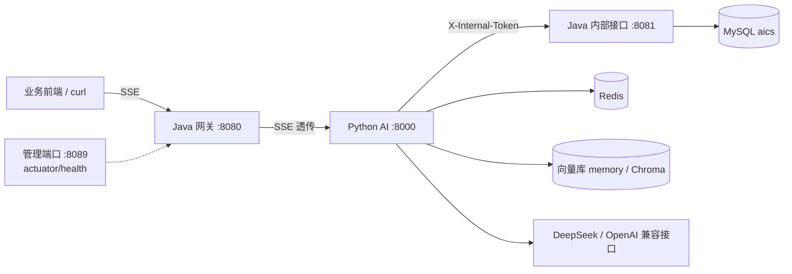
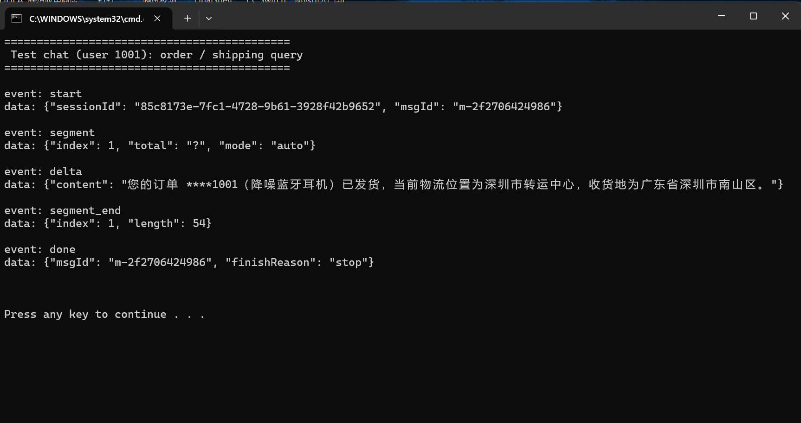

# AI 电商智能客服模块

[](https://github.com/111897/ai-poweredCustomerServiceforE-commerce/actions/workflows/ci.yml)

> ⚠️ **重要：`db/schema.sql` 含 `DROP TABLE`，仅用于全新数据库。**
> 对已有数据的库请使用 `db/migrate_2026_11_*.sql` 定向迁移，切勿直接执行 `schema.sql`。

基于《改需求1.txt》V1.2 与《项目设计规划.txt》V1.1 实现的模块化电商 AI 客服：
**Java 网关 + Python AI 编排双服务**，对外仅暴露一个 SSE 对话接口。

## 功能特性

- **SSE 流式对话**：`start → segment → delta → segment_end → done`，15 秒心跳，客户端断开自动取消
- **RAG 多子库检索**：FAQ / 商品 xlsx 知识库，列头校验、60 秒热更新、阈值调优
- **双向合规**：输入/输出违禁词（AC 自动机 + 正则）、越界拦截、歧义澄清
- **订单数据最小化**：库内脱敏视图 + Java 侧二次脱敏 + 用户级数据隔离
- **会话记忆**：Redis / 进程内双后端，Redis 故障自动降级，30 分钟 TTL
- **回答治理**：单段 ≤200 字、最多 5 段、30 题上下文压缩
- **安全底座**：JWT（exp/iss/aud）、内部接口独立端口、CORS 白名单、限流、审计落盘

## 架构



## 安全边界

| 端口 | 暴露范围 | 用途 | 保护 |
|---|---|---|---|
| 8080 | 本机 / 公网 | 唯一对话接口 `/api/chat/stream` | JWT 或 dev 回环 + 限流 |
| 8081 | 仅内网 | `/internal/orders`、`/internal/products` | `INTERNAL_TOKEN`，公网端口直接 404 |
| 8089 | 仅本机 | `/actuator/health` | 不输出组件详情 |
| 8000 | 仅内网 | Python `/internal/chat` | `INTERNAL_TOKEN`，不对外发布 |
| 3306 / 6379 | 本机 | MySQL / Redis | 本地绑定，生产需网络隔离 |

**鉴权模式**

- `AICS_AUTH_MODE=jwt`（默认）：校验 `Authorization: Bearer <token>`，强制 `exp`、`iss`、`aud`
- `AICS_AUTH_MODE=dev`：仅允许 `127.0.0.1/::1`，读取 `X-Debug-User-Id`，**生产禁止使用**
- `AICS_DEV_ALLOW_REMOTE=true`：仅本地 Docker demo 显式开启；严格模式禁止

**数据库最小权限**

- `aics_ro` 只拥有 `v_order_ai_safe`、`v_order_item_ai_safe`、`products` 的 `SELECT`
- 订单号在视图内脱敏（`****1001`），无法直接查询 `orders` / `order_items` 基表
- 回滚开关：`ORDER_USE_VIEW=false`

## 快速开始

### 1. 环境要求

- Java 17、Maven 3.9+
- Python 3.11+（本项目在 3.13 验证）
- MySQL 8.x；Redis 7（可选，未安装时自动回退进程内记忆）
- DeepSeek / 任意 OpenAI 兼容接口的 API Key（也可先用 `LLM_MOCK=true`）

### 2. 数据库

**全新库**（会删表，仅在空库执行）：

```bash
mysql -uroot -p --default-character-set=utf8mb4 < db/schema.sql
mysql -uroot -p --default-character-set=utf8mb4 < db/grant_readonly.sql
```

**已有数据的库**（定向迁移，不删数据）：

```bash
mysql -uroot -p --default-character-set=utf8mb4 < db/migrate_2026_11_order_views.sql
# 构建并验证新 jar 后，再收窄权限
mysql -uroot -p --default-character-set=utf8mb4 < db/migrate_2026_11_grant_readonly.sql
```

回滚：

```bash
mysql -uroot -p --default-character-set=utf8mb4 < db/rollback_2026_11_order_views.sql
# 同时设置 ORDER_USE_VIEW=false 或回退旧 jar
```

### 3. 配置

```bash
# 在项目根目录创建 .env（必须放根目录，服务从根目录启动）
copy python-service\.env.example .env
```

至少填写：

```dotenv
# 与 scripts\start-java.bat 中的 INTERNAL_TOKEN 保持一致
INTERNAL_TOKEN=local-aics-internal-7f3c9b2e6d1a4c8f
JAVA_INTERNAL_BASE_URL=http://127.0.0.1:8081

# 接入真实模型
LLM_MOCK=false
LLM_BASE_URL=https://api.deepseek.com/v1
LLM_API_KEY=sk-你的Key
LLM_MODEL=deepseek-chat

# Redis（可选）
MEMORY_BACKEND=redis
REDIS_URL=redis://127.0.0.1:6379/0
```

> **Key 安全**：`.env` 已加入 `.gitignore`；若 Key 曾在聊天/截图中出现，请在控制台轮换。

### 4. 启动（本地 dev 模式）

按顺序双击（均在 `scripts\` 目录下）：

1. `scripts\start-python.bat`：看到 `AI 服务已启动`、`会话记忆后端：redis`
2. `scripts\start-java.bat`：看到 `Started AicsApplication`、`安全启动校验通过`
3. `scripts\test-chat.bat`：看到 `event: start → segment → delta → segment_end → done`

浏览器 demo：

```bash
# 双击 scripts\start-web.bat，然后打开 http://127.0.0.1:5500
```

健康检查：

- Python：`http://127.0.0.1:8000/health`
- Java：`http://127.0.0.1:8089/actuator/health`（公网 8080 不暴露 actuator）

### 5. JWT 全链路演示

1. 双击 `scripts\start-java-jwt.bat`（`AICS_AUTH_MODE=jwt` + dev-token 端点）
2. 双击 `scripts\test-jwt.bat`：先取 dev-token，再带 Bearer 调 SSE
3. 不带 token 或只带 `X-Debug-User-Id` 均返回 401

## 配置项

| 变量 | 默认 | 说明 |
|---|---|---|
| `AICS_AUTH_MODE` | `jwt` | `jwt` / `dev`（dev 仅回环） |
| `INTERNAL_TOKEN` | 无 | Java 与 Python 共享密钥，必须显式配置 |
| `JWT_SECRET` | 无 | jwt 模式必填，≥32 字节 |
| `INTERNAL_PORT` | `8081` | 内部数据接口端口，`<=0` 关闭 |
| `MANAGEMENT_PORT` | `8089` | Actuator 管理端口 |
| `JAVA_INTERNAL_BASE_URL` | `http://127.0.0.1:8081` | Python 调 Java 内部接口 |
| `MEMORY_BACKEND` | `memory` | `memory` / `redis` |
| `SESSION_TTL_SECONDS` | `1800` | 会话记忆 TTL |
| `LLM_MOCK` | `true` | `false` 时调用真实模型 |
| `LLM_BASE_URL` / `LLM_API_KEY` / `LLM_MODEL` | - | OpenAI 兼容接口 |
| `RAG_MIN_SCORE` | `0.3` | hash 向量建议 0.2~0.5 |
| `MAX_ANSWER_CHARS` / `MAX_SEGMENTS` | `200` / `5` | 分段治理 |
| `RATE_LIMIT_ENABLED` | `true` | 公网 SSE 限流开关 |
| `ORDER_USE_VIEW` | `true` | 订单查询走脱敏视图 |

## SSE 事件协议

| 事件 | data 关键字段 | 说明 |
|---|---|---|
| `start` | `sessionId`, `msgId` | 会话开始 |
| `warning` | `type`, `message` | `banned` / `out_of_scope` / `ambiguous` |
| `segment` | `index`, `mode` | 一个文本段开始 |
| `delta` | `content` | 段内增量文本 |
| `segment_end` | `index`, `length` | 一个文本段结束（length ≤200） |
| `done` | `finishReason` | `stop` / `blocked` / `limit` / `clarify` / `error` |
| `error` | `code`, `message` | 内部错误 |

所有 `delta` 都被 `segment/segment_end` 包裹；心跳为 `: ping` 注释帧。

## 测试与质量

```bash
# Java 单元测试
cd java-service && mvn test

# Python 单元测试
cd python-service && pytest -q

# 静态检查（可选）
cd python-service && ruff check app tests
```

GitHub Actions 会在 push/PR 时运行上述测试（`.github/workflows/ci.yml`）。

### RAG 离线评测

20 条标注问法，知识库 11 个分块，HashEmbedder：

| 指标 | 结果 |
|---|---|
| Recall@1 | 95.0% |
| Recall@3 | 95.0% |
| Recall@5 | 100.0% |
| MRR | 0.960 |

完整报告：[docs/eval/rag_eval.md](docs/eval/rag_eval.md)

### SSE 压测

本地 dev 模式、真实 DeepSeek、6 请求 / 3 并发：

| 指标 | 结果 |
|---|---|
| 成功率 | 100%（0 失败） |
| TTFT 平均 | 3181 ms |
| TTFT P95 | 4980 ms |
| 总耗时 P95 | 5.00 s |

> 时延受网络与模型限流影响，数据仅用于本地回归对比。



## 目录

```
ai电商智能客服/
├─ db/                         建表、视图迁移、授权与回滚 SQL
├─ data/knowledge/{faq,product,banned}/   xlsx 知识库
├─ data/eval/rag_cases.json    RAG 评测集
├─ java-service/               Spring Boot 3 / Java 17
├─ python-service/             FastAPI / Python 3.13
├─ web/index.html              流式对话网页 demo
├─ scripts/                    启动/测试 .bat、JWT 演示、SSE 压测
├─ .github/workflows/ci.yml    CI
├─ docker-compose.yml
└─ README.md
```

## 已知限制

- **HashEmbedder 是演示级**：语义能力有限，生产建议切换 `sentence_transformers` + BGE-m3，并加入 rerank
- **限流是单机内存实现**：多实例部署需换成 Redis 令牌桶
- **Dockerfile 未在本机验证**：当前机器未安装 Docker，CI 也未构建镜像
- **无 Prometheus / 链路追踪**：目前只有结构化日志 + traceId
- **dev 鉴权仅限回环**：生产必须使用 jwt，并由上游系统签发 token
- **会话只保留 30 分钟**：不会持久化长期对话历史
- **审计日志为本地轮转文件**：未接入集中式日志平台

## License

[MIT](LICENSE)
